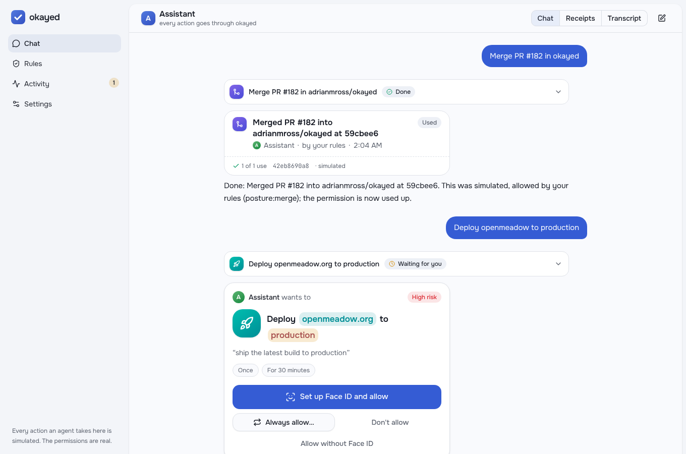
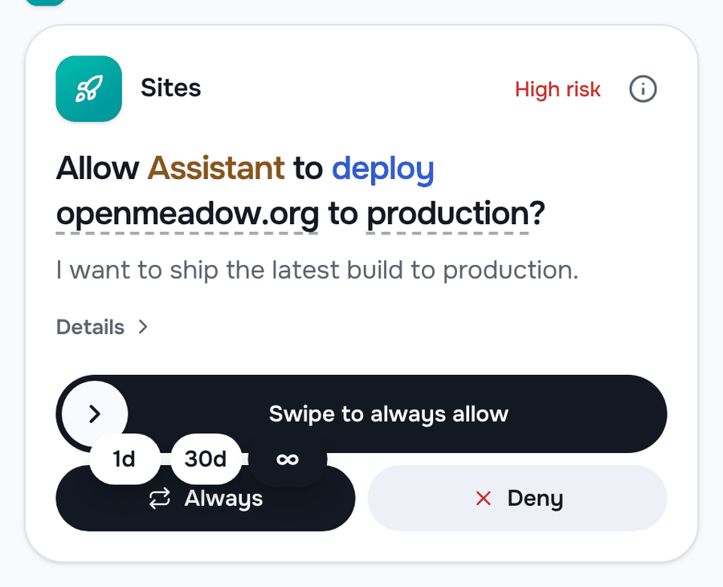
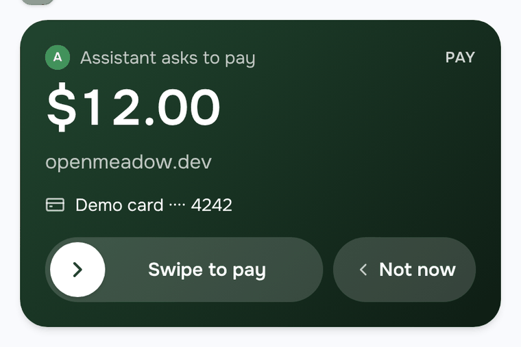
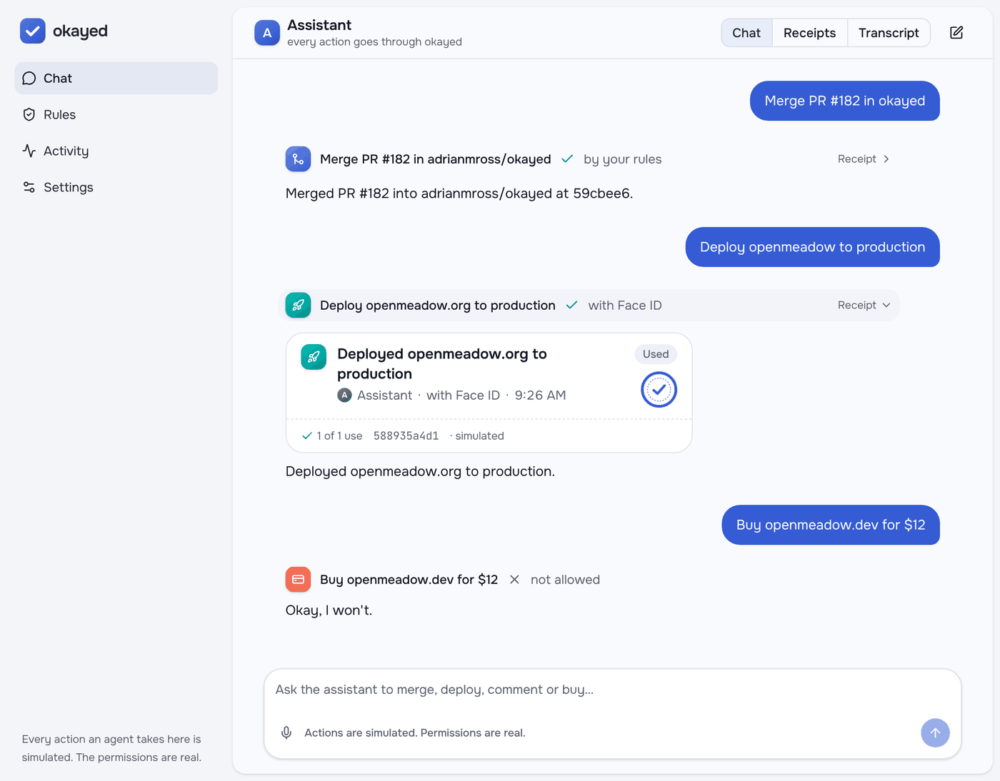
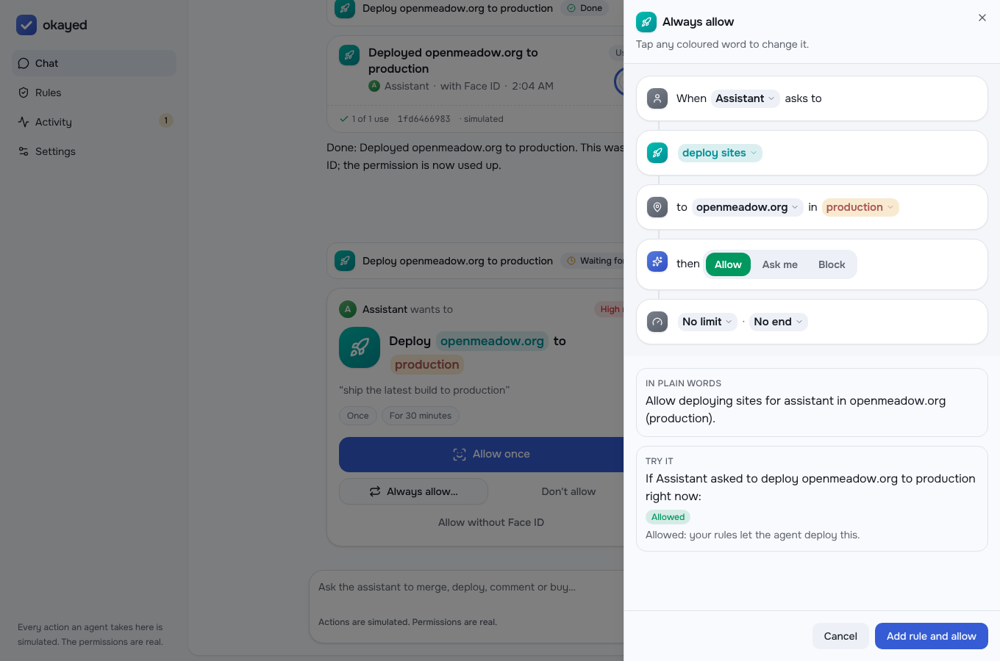
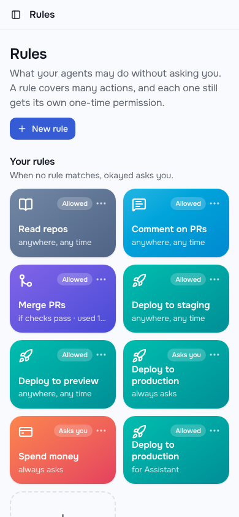
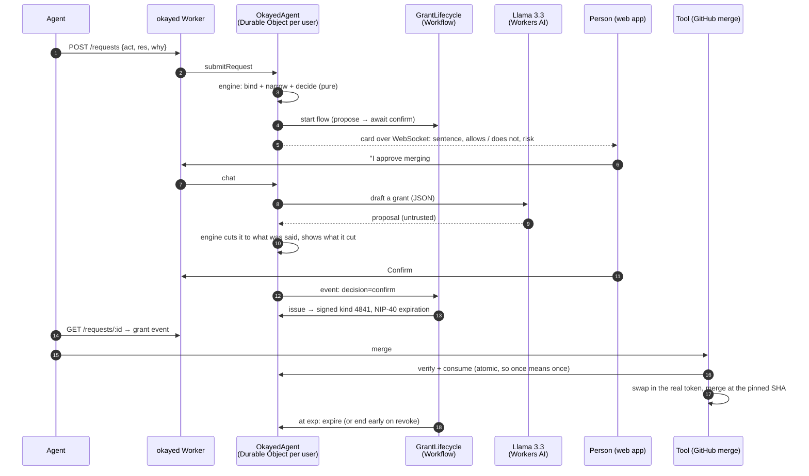

# okayed

**Scoped-authority approvals for AI agents.** People tell their agents things like *"I approve merging #182"* or
*"go ahead and deploy the website"*. Nothing can verify a sentence like that. okayed turns it into the **narrowest
exact, signed, expiring grant** it can mean, shows that grant to the person to confirm, and lets any tool verify the
grant before it acts.

> "I approve merging #182" → **Lets assistant merge PR #182 in adrianmross/okayed at 3f9a1c2, once, within the next 15
> minutes.** It does not cover any other PR, a newer commit, a second use, or any other agent.

- **Web demo:** [okayed.winter-tooth-73af.workers.dev](https://okayed.winter-tooth-73af.workers.dev) · **Playground:** [/playground](https://okayed.winter-tooth-73af.workers.dev/playground/)
- Runs on Cloudflare, as one Worker: Workers AI (Llama 3.3, Whisper), the Agents SDK (a Durable Object per user,
  `AIChatAgent` for the chat, `McpAgent` for remote MCP), Workflows, Queues, KV, Analytics Engine, rate limiting,
  Access, Turnstile, AI Gateway and static assets. See [Cloudflare, end to end](#cloudflare-end-to-end). The core is
  provider-agnostic, and the components install into any shadcn app.
- MIT licensed. The prompts behind this AI-assisted build are in [`PROMPTS.md`](PROMPTS.md).

## The demo

Chat with an assistant that can merge pull requests, deploy sites, comment and buy things. Its tools are simulated:
nothing real happens. Every tool call still goes through okayed, and the permissions it signs are real.

- If your rules allow the call, it goes ahead with a one-time permission. The chat shows it as one line, with how it
  was allowed and its receipt a tap away.
- If they ask you, an approval card appears under that line: the service, the question in plain words ("Allow
  Assistant to deploy openmeadow.org to production?"), the agent's reason, and the details a tap away. **Swipe to
  allow** signs a WebAuthn assertion (Face ID, Touch ID) over that exact request, and the assertion travels with the
  permission. A purchase asks with a money card instead: the amount big, what it's for, **Swipe to pay** or Not now.
- If a rule blocks it, the assistant is refused and says so.

Nothing is decided by a tap. **Hold Always**, rest on how long (a day, 30 days, or until you remove it), slide up into
the track and swipe: that makes the narrowest rule that covers requests like this one and allows this one with the
same Face ID. **Hold Deny** to swipe left, resting on how long on the way to block requests like it. Tap Deny and it
waits for a left swipe; tap Always and its choices replace the pills. Prefer buttons? Pick them in Settings, stacked
or in a row. You can also **say** what you want: the mic hears you through Whisper on Workers AI, and the words land
in the box for you to read before sending.

Each conversation has three views: **Chat** (one line per action and the replies), **Receipts**, and **Transcript**
(every tool input and output, okayed request and grant, as data). **Rules** is a library you build like Siri
Shortcuts. **Activity** has what's waiting, the permissions agents hold right now (take any of them back), and a
history of signed receipts.

| The assistant asks; you swipe, with Face ID | Hold Always: rest on how long, then swipe |
|---|---|
|  |  |

| A purchase is a money card | The chat: one line per action |
|---|---|
|  |  |

| Make a rule… opens the narrowest rule | Your rules, on a phone |
|---|---|
|  |  |

The app speaks in everyday words (rules, permissions, receipts); the API and docs keep the IAM ones. See
[docs/rules.md](docs/rules.md#words).

## Why

Agents act under borrowed authority. Today that authority is a long-lived token plus a sentence in a chat log. The
agent decides what the sentence meant, and the tool trusts the agent. okayed makes the authority explicit and
answers three questions in miniature:

1. **Who is the agent acting for?** The grant is issued by the person's key (`iss`) to one agent (`aud`).
2. **What can it touch?** One action on exact targets: repo + PR + commit SHA, or site + environment. No wildcards.
3. **How do you take it back?** Every grant expires on its own. You can revoke any grant at any time, and an
   emergency stop revokes them all.

## How it works



**The model drafts; a deterministic engine decides.** Llama 3.3 does two things: it turns plain language into a
*proposed* grant or policy, and it explains requests in plain words. Allow and deny, narrowing, risk, lifetimes and
use counts all come from pure, tested TypeScript in [`packages/engine`](packages/engine). The engine treats the
model's output as hostile input. A prompt injection can at most make the model propose something the engine then
cuts, and the cut is shown on the card ("asked for X, granted Y, refused Z because …").

The grant format (JSON, JCS-hashed id, signed as a Nostr event, kinds 4840–4844 and 34840) is specified in
[`docs/grant-format.md`](docs/grant-format.md). The design notes, and where each design rule lives in the code, are
in [`docs/design.md`](docs/design.md).

## Run it

Node 22 and pnpm 10 (or `direnv allow` with [devenv](https://devenv.sh)). No Cloudflare login needed:

```bash
pnpm install
cp apps/worker/.dev.vars.example apps/worker/.dev.vars    # put `openssl rand -hex 32` in ISSUER_SECRET
pnpm build:site
pnpm dev:local                                             # http://localhost:8787
```

Tests, the agent API, remote MCP, secretspec and deploying are in [docs/running.md](docs/running.md).

## Cloudflare, end to end

Each person's okayed is a Durable Object: one instance per person, worldwide, with its own transactional storage and
one request at a time. That single writer is what makes "once means once", limits and Stop everything hold under
concurrency, with no database or lock service to run. [docs/cloudflare.md](docs/cloudflare.md) explains it, with
every binding and a request's path through them.

## Cloudflare assignment checklist

| Requirement | Here |
|---|---|
| LLM | Llama 3.3 70B on Workers AI (`@cf/meta/llama-3.3-70b-instruct-fp8-fast`): the demo assistant's tool calling (`apps/worker/src/chat.ts`), plus drafting and explaining approvals and rules (`adapters.ts`); Whisper for voice |
| Workflow / coordination | Agents SDK: `OkayedAgent` (a Durable Object per user) and `OkayedChat` (`AIChatAgent`, per user); `AgentWorkflow` for request → propose → await confirm → issue → expire/revoke |
| User input | Chat (`apps/web`, served by the Worker), with AI SDK tool approval wired to okayed and live state over the Agents SDK WebSocket. Voice: speak in the chat, transcribed by Whisper on Workers AI (not Realtime). |
| Memory / state | Chat history in `OkayedChat`'s SQLite; rules, limits, requests, grants with use counters, passkeys, paired approvers and the audit log in `OkayedAgent`; OAuth state in KV; optionally every signed event in R2 |

## More

- [Running okayed](docs/running.md): locally, as an agent, over MCP, deployed, and the repository layout
- [Rules, approvers and interpreting people](docs/rules.md): words, standing rules and limits, approver apps, model evals
- [Built to plug into anything](docs/platform.md): any runtime, capability packs, connectors, identity, interop
- [okayed on Cloudflare](docs/cloudflare.md): Durable Objects, every binding, a request's path
- [Design](docs/design.md), [grant format](docs/grant-format.md), [design system](docs/design-system.md),
  [other permission systems](docs/interop.md)

## License

[MIT](LICENSE) © 2026 Adrian Ross
