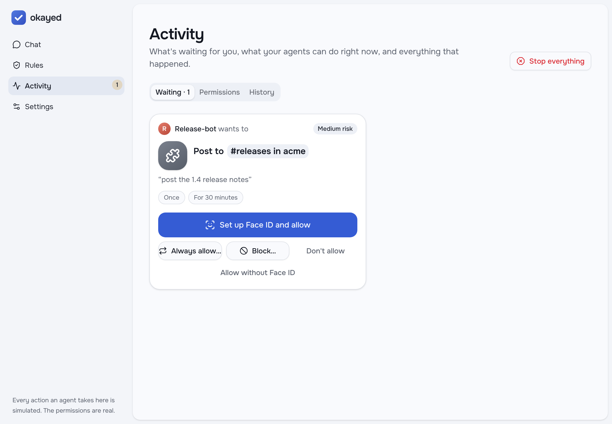
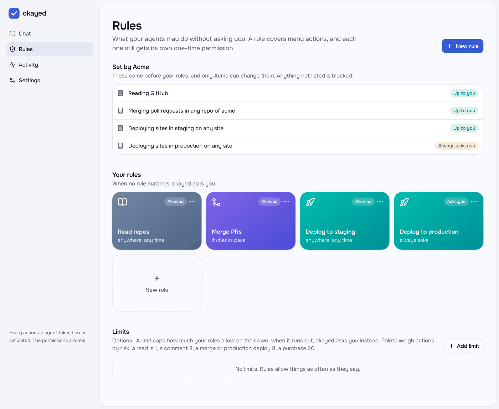

# Built to plug into anything

The core doesn't know about Cloudflare, GitHub or any one sign-in. Each of those plugs in.

## Any runtime

`packages/core` holds the service and its whole HTTP API on the Fetch API's `Request` and
`Response`, and uses only TypeScript syntax that can be stripped, so Node, Deno and Bun run it as is. Two runtimes
ship: the Cloudflare Worker (a Durable Object serves the API) and `apps/node` (SQLite and timers). The API smoke test
runs against both.

```bash
OKAYED_SECRET=$(openssl rand -hex 32) node apps/node/src/main.ts      # okayed on Node, on :8788
```

To port it elsewhere, implement `Store` (a serializable transaction per person: a Durable Object, SQLite, a Postgres
row lock), `Lifecycle` (Workflows, timers, Temporal), and pick a `Drafter` (Workers AI, any OpenAI-compatible
model, or none).

## Any action, as data

A capability pack declares a service's actions (risk, lifetimes, use counts, the words
people use for them) and its resource types as templates. Registered, its actions get everything the built-in ones
do: rules, decisions, narrowing, explanations, Face ID, signed grants and receipts.

```ts
registerPack({
  id: "linear", title: "Linear",
  resources: [{ kind: "linear.issue", template: "linear:{team}/{issue}", label: "{issue|upper} in {team}" }],
  actions: [{ act: "linear.issue.close", verb: "close", noun: "closing Linear issues", risk: "medium",
              ttl: 1800, maxTtl: 7200, uses: 1, maxUses: 10, res: ["linear.issue"], keywords: ["close"] }],
});
```

Example packs ship for Slack, email, Cloudflare DNS and S3; turn them on with `CAPABILITY_PACKS=slack,email,…` or
bring your own with `CAPABILITY_PACKS_JSON`.



## Any service, with the least credential

A connector does one thing under a grant: it checks the grant without
spending it (looking up any facts its conditions need), spends one use, acts and releases its credential. A
credential is either a stored secret or minted for that call alone:

| Connector | Credential |
|---|---|
| GitHub merge | A fine-grained token, or a GitHub App installation token for just that repository, revoked after |
| Cloudflare Pages deploy | An account token with only Pages Write, valid until the grant expires (ten minutes at most), deleted after |
| Cloudflare DNS change | A token with only DNS Write on just that zone, deleted after |
| Slack post | The workspace's bot token |

## Any way to prove who's asking and who's approving


| Who | How |
|---|---|
| The person | An owner token; or Cloudflare Access; or an ID token from any OIDC provider (Auth0, Okta, Google…) |
| An agent | An okayed agent token; or OAuth through remote MCP; or a **workload identity** token from its platform (GitHub Actions, Kubernetes, a cloud) that you trust in Settings, so CI holds no secret |
| The approval | A passkey (Face ID, Touch ID, a security key); or a paired approver app that signs with its own key |
| The organization | Its policy by group, with groups from SCIM, an OIDC groups claim, Cloudflare Access or SAML: a layer above each person's rules that only narrows them, and removal stops everything |

## Any permission vocabulary

`@okayed/interop` maps the systems already in use onto okayed's actions, resources
and principals: an organization's groups (SCIM, OIDC, SAML, Access) become limits above each person's rules; OAuth
scopes become a limit on an agent, and a grant says which scopes its credential needs; agents can ask in RFC 9396's
`authorization_details`, and a grant can be written back as them or as a UCAN delegation. Agents can be in groups too,
so one rule covers `group:deployers`. [interop.md](interop.md) has the mapping, the setup and what's not
done yet.


